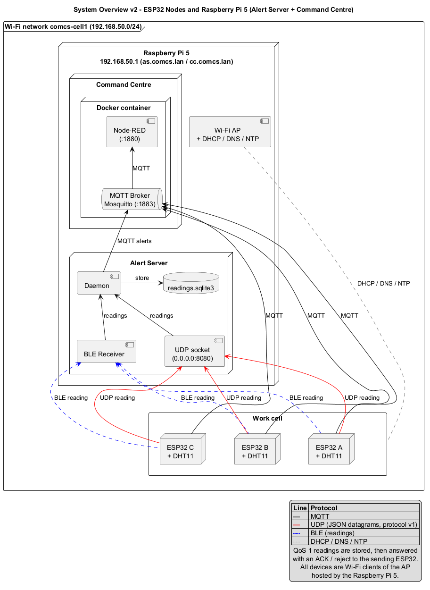
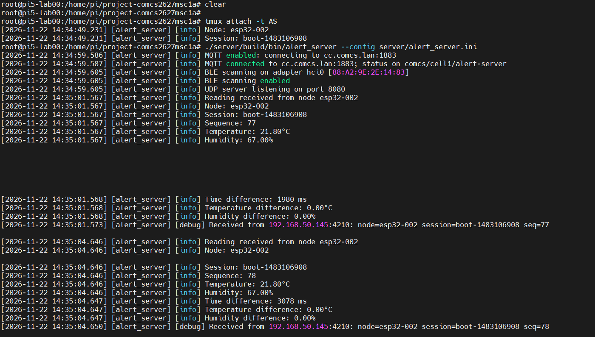
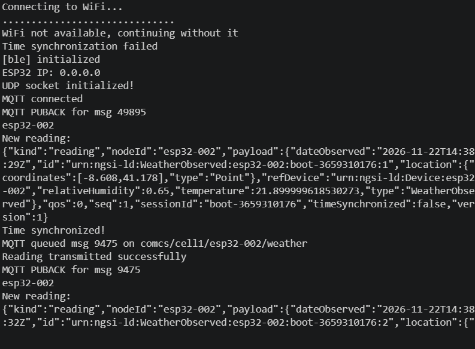

# Trabalho comcs grupo 1 <!-- omit in toc -->

- [Contexto](#contexto)
  - [Extras](#extras)
- [Design](#design)
  - [Servidor](#servidor)
    - [Envio de emails](#envio-de-emails)
  - [ESPs](#esps)
- [Instruções de build](#instruções-de-build)
  - [Setup centro de comandos](#setup-centro-de-comandos)
  - [Setup servidor](#setup-servidor)
  - [Setup ESP](#setup-esp)

## Contexto

O trabalho consiste em desenvolver um sistema de monitoramento de temperatura e humidade a usar ESP32s. 
O objetivo é recolher dados de sensores, transmiti-los para um servidor através de UDP e processá-los para enviar alertas por MQTT para um centro de comandos NodeRed. O centro de comando também recebe dados directamente das nodes para grafar os dados dos sensores ao longo do tempo.



<br><br>

### Extras

A nossa equipa decidiu também implementar certos extras, nomeadamente:
- Redundância, através de BLE, o protocolo de redundância será explicado depois
- Componentes extra na parte electrónica para visualização de estado
- Visualização de estado de cada ESP no centro de comandos
- Envio de e-mails de aviso a cada warning
- Servidor corss platform (Linux e Windows)

## Design

### Servidor 

O servidor foi escrito em C++ para podermos mais facilmente criar testes unitários e ter à nossa disposição mais livrarias, assim como melhor organização do código ao ter acesso a classes.

O servidor é platform independent e tem implementações Posix e Windows onde necessário.

#### Serviço UDP <!-- omit in toc -->

##### Protocolo <!-- omit in toc -->

O protocolo é uma livraria partilhada entre os ESPs e o servidor, o formato é este

```json
{
  "version": 1,
  "kind": "reading",
  "qos": 1,
  "nodeId": "esp32-a",
  "sessionId": "c79e4fd8-5888-4ae5-8556-c1e558aa6020",
  "seq": 42,
  "timeSynchronized": true,
  "payload": {
    "id": "urn:ngsi-ld:WeatherObserved:esp32-a:c79e4fd8-5888-4ae5-8556-c1e558aa6020:42",
    "type": "WeatherObserved",
    "dateObserved": "2026-11-02T14:30:01Z",
    "location": {"type": "Point", "coordinates": [-8.608, 41.178]},
    "refDevice": "urn:ngsi-ld:Device:esp32-a",
    "temperature": 23.4,
    "relativeHumidity": 0.56
  }
}
```

###### Respostas <!-- omit in toc -->

```json
{"version":1,"kind":"ack","nodeId":"esp32-a","sessionId":"boot-1","seq":42}
```

```json
{"version":1,"kind":"reject","nodeId":"esp32-a","sessionId":"boot-1","seq":42,"code":"invalid_payload","reason":"Invalid observation"}
```

Códigos de rejeição: `invalid_message`, `unsupported_version`, `invalid_payload`, `identity_conflict`

###### QoS <!-- omit in toc -->

QoS 0 significa enviar uma vez, sem ACK. QoS 1 significa entrega pelo menos uma vez, tentando novamente até ser reconhecido.

#### Persistência <!-- omit in toc -->

##### SQLite <!-- omit in toc -->

Os dados recebidos são guardados numa base de dados SQLite, cujo caminho é definido na configuração do servidor.

O servidor usa os dados persistidos para fazer comparações à medida que leituras são recebidas.

##### Logging <!-- omit in toc -->

O servidor utiliza spdlog para registar informação tanto na consola como no ficheiro `logs/alert_server.log`. 

Os registos incluem:
- Recepção de leituras
- Avisos
- Erros de mensagens inválidas, persistência e comunicação

#### Testes ao servidor <!-- omit in toc -->

O servidor foi testado a 2 níveis, temos testes unitários (nas pastas test) com GTests a todas as classes, e temos testes de sistema que validam se, recebidos pacotes UDP (com um fake UDP client na pasta tools) os dados são efectivamente persistidos na base de dados, e se os tópicos MQTT estão a efectivamente receber dados (com um spy MQTT broker também na pasta tools).

Os testes de sistema encontram-se na pasta e2e.

#### Documentação <!-- omit in toc -->

O servidor (e o código para os ESPs) foi documentado com comentários estilo doxygen e temos documentação auto-gerada a ser publicada automáticamente para este URL: [https://sagiri197.github.io/project-comcs2627msc1a/](https://sagiri197.github.io/project-comcs2627msc1a/)

#### Envio de emails

Os emails de alerta são enviados por um request HTTP para um flow de Microsoft Power Automate


### ESPs

#### Hardware <!-- omit in toc -->

Cada nó usa um ESP32 (ou S3, configuravel) e um sensor DHT11 para medir temperatura e humidade. 

Existem três perfis de configuração, com identificadores e coordenadas configuradas. A hora é obtida através de NTP, se não estiver sincronizada, a leitura não é enviada.

Para hardware extra os perfis também defininem variáveis opcionais com o pinout desejado do nó para cada componente (null para ignorar), os componentes em questão sºao um LED RGB para comunicar o estado de execução, um display de sete segmentos, e um motor com uma ventoinha para um mecanismo de cooling.

As esquemáticas do circuito idealizadas pela equipa são as seguintes:


#### Redundância <!-- omit in toc -->

Cada leitura é enviada por UDP a cada segundo (configurável) para o servidor de alertas e MQTT para o centro de comandos. Se um envio falhar, o ESP guarda a mensagem numa fila própria em SPIFFS e tenta reenviá-la quando a ligação voltar. 

Os dados são também enviados por BLE para o servidor, que está passivamente à escuta de envios por BLE além de UDP.

## Instruções de build

O projecto foi feito para correr com um AP, MQTT broker local e servidor a correr num raspberry PI, o setup local pode ser feito da seguinte maneira:

### Setup centro de comandos

O command centre deve ser a primeira coisa a ser começada.
O setup está contido dentro de uma docker image, para o começar, usa-se o comando:

```
docker compose up -d --build
```


Node-RED: http://192.168.60.1:1880

Dashboard: http://192.168.60.1:1880/dashboard

MQTT: 192.168.60.1:1883

### Setup servidor

Para baixar as dependencias do servidos, caso tenha feito `git clone`, é preciso baixar os sub módulos git.

```sh
git submodule update --init --recursive
```

O servidor foi feito em C++ com CMake, para tal é preciso ter o CMake instalado, um compilador de C++ (recomendado clang ou mingw em windows) e um build system (recomendado ninja). A build é feita normalmente:

```sh
cmake -S server -B server/build -DBUILD_TESTING=ON
cmake --build server/build -j2
```

`-DBUILD_TESTING=ON` indica ao CMake para incluir os ficheiros de teste, os testes (unit e e2e) podem ser corridos com ctest:
```sh
ctest --test-dir server/build
```

O servidor precisa de um ficheiro de configuração para correr, nesse ficheiro será preciso também definir os endpoints desejados para o MQTT broker e afins.
```sh
./server/build/bin/alert_server --config server/alert_server.ini
```

O nosso config está no caminho: `server/alert_server.ini`

Se tudo correr bem devemos ver algo como:



### Setup ESP

O ESP deve ser montado da mesma maneira indicada no capitulo de design, mas os extras podem ser ignorados ao configurar o ESP com null nos campos apropriados.

As nossas configurações estão na pasta `nodes/sketch/src/configs`, num setup local devem ser trocados o ssid e password do WIFI, o IP do servidor, o host do mqtt broker e tudo o resto que se ache relevante.

A configuração a usar é definida como uma macro no ficheiro `nodes/sketch/src/config.h`, mas como tal pode também ser passada como argumento ao compilador, que é o que fazemos no nosso `nodes/Makefile`, que usa a arduino-cli para automatizar o processo de flashing, mas o arduino IDE também serve.

A este ponto o serial monitor deverá mostrar os seguintes logs:
