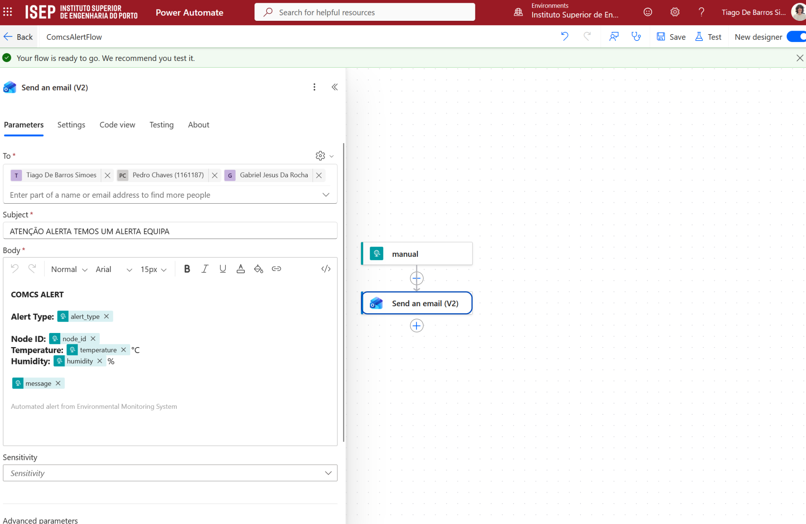
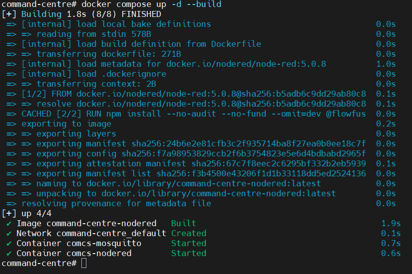

# Trabalho comcs grupo 1 <!-- omit in toc -->

- [Contexto](#contexto)
  - [Extras](#extras)
- [Design](#design)
  - [Servidor](#servidor)
    - [Envio de emails](#envio-de-emails)
  - [ESPs](#esps)
- [Instruções de build](#instruções-de-build)
  - [Setup centro de comandos](#setup-centro-de-comandos)
  - [Setup servidor](#setup-servidor)
  - [Setup ESP](#setup-esp)

## Contexto

O trabalho consiste em desenvolver um sistema de monitoramento de temperatura e humidade a usar ESP32s. 
O objetivo é recolher dados de sensores, transmiti-los para um servidor através de UDP e processá-los para enviar alertas por MQTT para um centro de comandos NodeRed. O centro de comando também recebe dados directamente das nodes para grafar os dados dos sensores ao longo do tempo.


<br><br>

### Extras

A nossa equipa decidiu também implementar os seguintes extras:
- Redundância da conexão, os nodes conectam-se ao Alert Server tanto por UDP como BLE
- Componentes extra na parte electrónica para visualização de estado
- Visualização de estado de cada ESP no centro de comandos
- Envio de e-mails de aviso a cada warning
- Servidor cross-platform (Linux e Windows)

## Design

### Servidor 

O servidor foi escrito em C++. Nesta linguagem temos acesso a bibliotecas robustas que utilizamos para funcionalidades como logging, BLE, testes unitários, entre outros. Também concluimos que é uma linguagem mais adequada para um sistema deste género, porque ao contrário de C, permite-nos aplicar desenvolvimento orientado a objetos. 

O servidor é suportado tanto em Windows como em Linux.

#### Serviço UDP <!-- omit in toc -->

##### Protocolo <!-- omit in toc -->

Foi definido o nosso próprio protocolo de comunicação, partilhado entre os Nodes e o servidor. 
Segue o seguinte formato, baseado em Smart Data:

```json
{
  "version": 1,
  "kind": "reading",
  "qos": 1,
  "nodeId": "esp32-a",
  "sessionId": "c79e4fd8-5888-4ae5-8556-c1e558aa6020",
  "seq": 42,
  "timeSynchronized": true,
  "payload": {
    "id": "urn:ngsi-ld:WeatherObserved:esp32-a:c79e4fd8-5888-4ae5-8556-c1e558aa6020:42",
    "type": "WeatherObserved",
    "dateObserved": "2026-11-02T14:30:01Z",
    "location": {"type": "Point", "coordinates": [-8.608, 41.178]},
    "refDevice": "urn:ngsi-ld:Device:esp32-a",
    "temperature": 23.4,
    "relativeHumidity": 0.56
  }
}
```

###### Respostas <!-- omit in toc -->

```json
{"version":1,"kind":"ack","nodeId":"esp32-a","sessionId":"boot-1","seq":42}
```

```json
{"version":1,"kind":"reject","nodeId":"esp32-a","sessionId":"boot-1","seq":42,"code":"invalid_payload","reason":"Invalid observation"}
```

Códigos de rejeição: `invalid_message`, `unsupported_version`, `invalid_payload`, `identity_conflict`

###### QoS <!-- omit in toc -->

QoS 0 significa enviar uma vez, sem ACK. QoS 1 significa entrega pelo menos uma vez, tentando novamente até ser reconhecido.

#### Persistência <!-- omit in toc -->

##### SQLite <!-- omit in toc -->

Os dados recebidos são guardados numa base de dados SQLite, cujo caminho é definido na configuração do servidor.

O servidor usa os dados persistidos para fazer comparações à medida que leituras são recebidas.

##### Logging <!-- omit in toc -->

O servidor utiliza a biblioteca spdlog para registar informação tanto na consola como no ficheiro `logs/alert_server.log`. 

Os registos incluem:
- Recepção de leituras
- Avisos
- Erros de mensagens inválidas, persistência e comunicação

#### Testes ao servidor <!-- omit in toc -->

O servidor foi testado a 2 níveis, temos testes unitários (nas pastas test) com GTests a todas as classes, e temos testes de sistema que validam se, recebidos pacotes UDP (com um fake UDP client na pasta tools) os dados são efectivamente persistidos na base de dados, e se os tópicos MQTT estão a efectivamente receber dados (com um spy MQTT broker também na pasta tools).

Os testes de sistema encontram-se na pasta e2e.

#### Documentação <!-- omit in toc -->

O servidor (e o código para os ESPs) foi documentado com comentários estilo doxygen e temos documentação auto-gerada a ser publicada automáticamente para este URL: [https://sagiri197.github.io/project-comcs2627msc1a/](https://sagiri197.github.io/project-comcs2627msc1a/)

#### Envio de emails

Os emails de alerta são enviados por um request HTTP para um flow de Microsoft Power Automate



### ESPs

#### Hardware <!-- omit in toc -->

Cada nó usa um ESP32 (ou S3, configuravel) e um sensor DHT11 para medir temperatura e humidade. 

Existem três perfis de configuração, com identificadores e coordenadas configuradas. A hora é obtida através de NTP, se não estiver sincronizada, a leitura não é enviada.

Para hardware extra os perfis também defininem variáveis opcionais com o pinout desejado do nó para cada componente (null para ignorar), os componentes em questão sºao um LED RGB para comunicar o estado de execução, um display de sete segmentos, e um motor com uma ventoinha para um mecanismo de cooling.

As esquemáticas do circuito idealizadas pela equipa são as seguintes:


#### Redundância <!-- omit in toc -->

Cada leitura é enviada por UDP a cada segundo (configurável) para o servidor de alertas e MQTT para o centro de comandos. Se um envio falhar, o ESP guarda a mensagem numa fila própria em SPIFFS e tenta reenviá-la quando a ligação voltar. 

Os dados são também enviados por BLE para o servidor, que está passivamente à escuta de envios por BLE além de UDP.

## Instruções de build

O projecto foi feito para correr com um AP, MQTT broker local e servidor a correr num raspberry PI, o setup local pode ser feito da seguinte maneira:

### Setup centro de comandos

O command centre deve ser a primeira coisa a correr.
O setup está contido dentro de uma docker image, para o começar, usa-se o comando:

```
docker compose up -d --build
```



Node-RED: http://192.168.60.1:1880

Dashboard: http://192.168.60.1:1880/dashboard

MQTT: 192.168.60.1:1883

### Setup servidor

Para inicializar o repositório:

```sh
git clone https://github.com/Sagiri197/project-comcs2627msc1a.git
git submodule update --init --recursive
```

Para compilar o Alert Server, é necessário o CMake e um compilador de C++.

```sh
# build com testes
cmake -S server -B server/build -DBUILD_TESTING=ON

#build sem testes
cmake -S server -B server/build

# iniciar compilação
cmake --build server/build -j2

# correr testes
ctest --test-dir server/build

# correr servidor 
./server/build/bin/alert_server --config server/alert_server.ini
```

Output esperado:


### Setup ESP

Disponibilizamos um Makefile para automatizar o processo de compilação e upload.

Exemplo, para NODE_PROFILE == 1 (ver nodes\sketch\src\config.h): 

```sh
make -C nodes flash-monitor NODE=1
```

As configurações estão na pasta `nodes/sketch/src/configs`.
Nestes ficheiros podem ser configuradas as definições para cada Node, como o SSID, password, MQTT Server, etc.

A este ponto o serial monitor deverá mostrar os seguintes logs:
